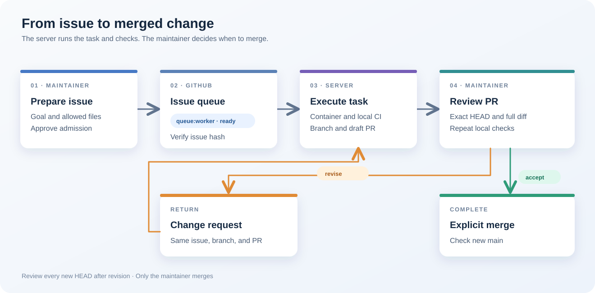

# Ermik

Ermik is a self-hosted GitHub Issues queue for coding agents. It runs admitted tasks in separate Docker containers, performs local CI without GitHub Actions, and opens draft pull requests for human review. Multiple model providers can share the queue, with fallback when an account reaches its limit. A maintainer reviews the exact commit, requests changes in the same PR if needed, and explicitly merges.



## Current capabilities

- Admission is tied to the issue body and allowed paths through a maintainer comment. Only open issues with `queue:worker` and `state:ready` are eligible.
- A configured worker runs in an isolated checkout. The controller validates changed paths, runs configured checks without network access, pushes the branch, and opens one draft PR.
- `review` reruns checks on the exact PR HEAD. `request-changes` continues in the same PR. `merge` requires a current review record and checks the new base commit after merging.
- A deterministic demo worker and an OpenCode worker with configurable model routing are included. Each new project must supply suitable worker and check commands and verify its own complete issue-to-merge cycle.

The [documented trial](docs/readiness.md) completed an issue, draft PR, correction, second review, merge, and `main` check in a separate GitHub repository using the two configured provider connections. That result applies to the trial configuration.

## Five-step trial

1. Follow the [first-project walkthrough](docs/first-project.md) for a disposable repository. For separate server and maintainer hosts, follow [setup](docs/setup.md) and [security](docs/security.md).
2. Copy [the example configuration](examples/config.example.json) to `config.json` on each host. Set the same `owner/repo`, maintainer, image, worker command, and checks. Give each host its own private `state_dir` and `workspace`. Keep secrets outside JSON.
3. Build the demo image, then inspect the read-only preflight:

   ```sh
   docker build -f examples/Dockerfile.demo -t ermik-demo:latest .
   python3 -m ermik --config config.json doctor
   python3 -m ermik --config config.json status
   ```

4. Create an issue from [the example body](examples/issue.md) with `queue:worker` and `state:proposed`. Replace `ISSUE_NUMBER` with the number in its GitHub URL. The maintainer admits it on their computer; the server takes it:

   ```sh
   python3 -m ermik --config config.json admit ISSUE_NUMBER
   python3 -m ermik --config config.json run-once
   ```

5. Inspect the draft PR and its diff. Replace `PR_NUMBER` with the number returned by `run-once` (also shown in the PR URL). Record review, request a correction if needed, then review the new HEAD before merging:

   ```sh
   python3 -m ermik --config config.json review PR_NUMBER
   python3 -m ermik --config config.json request-changes PR_NUMBER --note-file /private/review.txt
   python3 -m ermik --config config.json review PR_NUMBER
   python3 -m ermik --config config.json merge PR_NUMBER
   ```

For a copyable example that creates the issue and captures both numbers automatically, follow the [first-project walkthrough](docs/first-project.md). For continuous operation, use `python3 -m ermik --config config.json poll`. Set `"max_parallel": 2` only after verifying independent file and resource scopes.

## Limits and evidence

One trusted controller owns each state directory. Configuration allows up to eight concurrent jobs and 32 model entries; a PR may change at most 100 files. A confirmed HTTP 429 puts the account on a 15-minute cooldown; another eligible model can take the task. Ambiguous remote writes require reconciliation before retry.

The worker container receives no GitHub credential. The publishing controller remains trusted. For private repositories on GitHub Free, do not treat `main` branch protection as an enforced boundary. Passing checks establish only what those commands tested; manual or hardware gates remain maintainer decisions.

```sh
python3 -m unittest discover -s tests -v
python3 -m compileall -q ermik
```

## Roadmap

The [v0.2.0 milestone](https://github.com/greggubarev/ermik/milestone/1) tracks release-readiness work, including crash recovery, separate publication credentials, clean-host setup, provider failures, host reboot, immutable images, vulnerability reporting, and upgrades of the local SQLite state. The current version remains a preview; [release readiness](docs/readiness.md) records what has and has not been verified.

## Documentation

| Guide | Subject |
| --- | --- |
| [Setup](docs/setup.md) and [first project](docs/first-project.md) | Installation and complete trial |
| [Maintainer](docs/maintainer.md) and [worker](docs/worker.md) | Issue admission, execution, review, and merge |
| [Security](docs/security.md) and [PR broker](docs/pr-broker.md) | Credentials and publication boundaries |
| [Local CI](docs/local-ci.md), [status](docs/status.md), and [dashboard](docs/dashboard.md) | Checks and observability |
| [Providers](docs/providers.md) and [troubleshooting](docs/troubleshooting.md) | Model routing and recovery |
| [Architecture](docs/architecture.md) and [readiness](docs/readiness.md) | State machine, verified behavior, and open work |

Source code is available under the [MIT License](LICENSE). Components added to a custom task image retain their own licenses and terms.
