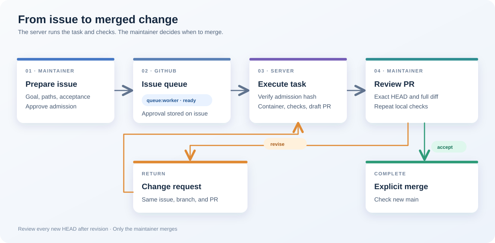

# Ermik

Ermik is a coined name inspired by the [ermine](https://www.nature.scot/plants-animals-and-fungi/mammals/land-mammals/other-carnivores/stoat-and-weasel): the stoat in its white winter coat. It is not an acronym.

Ermik is a self-hosted path from scoped GitHub Issues to draft pull requests. A maintainer admits an issue; a trusted controller runs the configured task command in a separate Docker container, validates the changed paths, and runs local checks without requiring GitHub Actions. The maintainer reviews the exact PR commit and is the only party that initiates a merge. This is a preview: the documented end-to-end trial verifies one disposable repository and its configuration, not every project or failure mode.



## What we are building

The goal is a reusable execution queue that can work through admitted Issues while the maintainer is away. Each task gets an isolated checkout, a configured runner and local checks. The controller publishes one draft PR per Issue and sends requested changes back to the same PR. Safe resumption after interruptions is a v0.2 goal still under test. A separate maintainer installation verifies the current HEAD and decides when to merge. The execution loop does not merge; the [security model](docs/security.md) explains the credentials needed to enforce that boundary.

The controller can export a bounded record of checks and task identity for the maintainer. Optional GitHub comment delivery is under verification. Later releases aim to compare provider routes by accepted PR outcomes and cost and explain blocked or waiting work through optional local views. The [release status](docs/readiness.md) lists what has actually been verified.

## Current capabilities

- Admission is tied to the issue body and allowed paths through a maintainer comment. Only open issues with `queue:worker` and `state:ready` are eligible.
- A configured worker runs in an isolated checkout. The controller validates changed paths, runs configured checks without network access, pushes the branch, and opens one draft PR.
- `review` reruns checks on the exact PR HEAD. `request-changes` continues in the same PR. `merge` requires a current review record and checks the new base commit after merging.
- `storage` inventories private task artifacts and previews bounded retention cleanup. Deletion requires a verified merged record and explicit `--apply` limits.
- `export-evidence` creates a bounded record for one PR HEAD; `verify-evidence` checks it against current GitHub and local policy before maintainer review. [The manifest guide](docs/evidence.md) explains its trust limits.
- Optional `publish-evidence` and `fetch-evidence` transfer that record through a PR comment. The receiver checks the current HEAD and pinned publisher identity; the transport does not attest to the controller's check results.
- `review-packet` gives the maintainer a read-only view of one PR's current evidence, earlier HEAD, manual criteria, and local review status. It marks stale or missing evidence explicitly and never merges.
- `decision-history` shows a bounded private trail of exact-HEAD reviews, correction requests, and explicit merge outcomes. Its digest comes from local check evidence; the history is never an approval signal.
- A deterministic demo task command and a configurable task runner are included. Provider routing can retry an eligible route after a confirmed rate limit. Each new project must supply suitable task and check commands and verify its own complete issue-to-merge cycle.

The [documented trial](docs/readiness.md) completed admission, a draft PR, correction on the same PR, a second review, explicit merge, and a check on the resulting default branch in a separate GitHub repository. The two configured provider routes also completed live tasks. These results apply to the trial configuration.

## Five-step trial

1. Follow the [first-project walkthrough](docs/first-project.md) for a disposable repository. For separate server and maintainer hosts, follow [setup](docs/setup.md) and [security](docs/security.md).
2. Copy [the example configuration](examples/config.example.json) to `config.json` on each host. Set the same `owner/repo`, maintainer, image, worker command, and checks. Give each host its own private `state_dir` and `workspace`. Keep secrets outside JSON.
3. Build the demo image, then inspect the read-only preflight. It verifies identity and prerequisites; publication write capability remains unverified until `run-once` or `poll`:

   ```sh
   docker build -f examples/Dockerfile.demo -t ermik-demo:latest .
   python3 -m ermik --config config.json doctor
   python3 -m ermik --config config.json status
   ```

4. Create an issue from [the example body](examples/issue.md) with `queue:worker` and `state:proposed`. Replace `ISSUE_NUMBER` with the number in its GitHub URL. The maintainer admits it on their computer; the server takes it:

   ```sh
   python3 -m ermik --config config.json admit ISSUE_NUMBER
   python3 -m ermik --config config.json run-once
   ```

5. Inspect the draft PR and its diff. Replace `PR_NUMBER` with the number returned by `run-once` (also shown in the PR URL). Record review, request a correction if needed, then review the new HEAD before merging:

   ```sh
   python3 -m ermik --config config.json review PR_NUMBER
   python3 -m ermik --config config.json request-changes PR_NUMBER --note-file /private/review.txt
   python3 -m ermik --config config.json review PR_NUMBER
   python3 -m ermik --config config.json merge PR_NUMBER
   ```

For a copyable example that creates the issue and captures both numbers automatically, follow the [first-project walkthrough](docs/first-project.md). For continuous operation, use `python3 -m ermik --config config.json poll`. Set `"max_parallel": 2` only after verifying independent file and resource scopes.

## Limits and evidence

One trusted controller owns each state directory. Configuration allows up to eight concurrent jobs and 32 model entries; a PR may change at most 100 files. A confirmed HTTP 429 puts the account on a 15-minute cooldown; another eligible model can take the task. Ambiguous remote writes require reconciliation before retry.

The worker container receives no GitHub credential. The publishing controller remains trusted. For private repositories on GitHub Free, do not treat `main` branch protection as an enforced boundary. Passing checks establish only what those commands tested; manual or hardware gates remain maintainer decisions.

Report security vulnerabilities through the [private reporting channel](SECURITY.md). Run the [source release gate](docs/release.md) on each reviewed release commit before publishing an archive.

```sh
python3 -m unittest discover -s tests -v
python3 -m compileall -q ermik
```

## Roadmap

The [phased roadmap](docs/roadmap.md) defines the acceptance gates. The milestones group concrete Issues; they are not release dates.

| Milestone | Planned result |
| --- | --- |
| [v0.2.0](https://github.com/greggubarev/ermik/milestone/1) | Recover interrupted writes and merge decisions, prove separated credentials, pin execution identity, and validate upgrades and a clean installation. |
| [v0.3.0](https://github.com/greggubarev/ermik/milestone/2) | Deliver portable evidence to a separate maintainer installation and make stale review decisions visible. |
| [v0.4.0](https://github.com/greggubarev/ermik/milestone/3) | Measure provider outcomes, quota observations, context use and cost per accepted PR before changing routing policy. |
| [v0.5.0](https://github.com/greggubarev/ermik/milestone/4) | Add optional diagnostics and views, and validate the setup on unrelated projects. |

Ermik remains a preview while the v0.2 recovery and credential gates are open. See [release status](docs/readiness.md) for verified trials and [Releases](https://github.com/greggubarev/ermik/releases) when a version is published.

## Documentation

| Guide | Subject |
| --- | --- |
| [Setup](docs/setup.md) and [first project](docs/first-project.md) | Installation and complete trial |
| [Maintainer](docs/maintainer.md) and [worker](docs/worker.md) | Issue admission, execution, review, and merge |
| [Security policy](SECURITY.md), [security model](docs/security.md), and [PR broker](docs/pr-broker.md) | Private reporting, credentials, and publication boundaries |
| [Local CI](docs/local-ci.md), [status](docs/status.md), [dashboard](docs/dashboard.md), and [storage](docs/storage.md) | Checks, observability, and local artifact retention |
| [Providers](docs/providers.md) and [troubleshooting](docs/troubleshooting.md) | Model routing and recovery |
| [Architecture](docs/architecture.md), [image continuity](docs/image-continuity.md), [evidence](docs/evidence.md), and [readiness](docs/readiness.md) | State machine, image identity, PR handoff record, verified behavior, and open work |
| [Roadmap](docs/roadmap.md) | Phases and acceptance criteria |
| [Source release](docs/release.md) | Archive, privacy scan, notices, and secret response |

Source code is available under the [MIT License](LICENSE). Components added to a custom task image retain their own licenses and terms.
