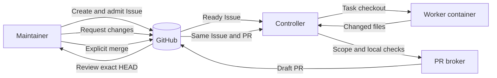

# Architecture

Ermik has two installations: a controller on the execution host and a maintainer on a separate machine. They share GitHub Issues and pull requests, but keep separate local state. The controller uses SQLite for admissions, reservations, jobs, retries, and usage observations. A file lock allows one controller per state directory.

## State and ownership

| State | Owner | Meaning |
| --- | --- | --- |
| `state:proposed` | Maintainer | Issue is drafted but not eligible for execution. |
| `state:ready` | Maintainer `admit` | An approval comment binds the Issue body hash and allowed paths. |
| `running` / `state:in-progress` | Controller | Scope is reserved; one checkout and container execute the task. |
| `awaiting_review` | Controller | A draft PR is published at a recorded HEAD; the execution slot is free. |
| `correcting` | Maintainer comment, then controller | The worker updates the same branch and PR; checks run again. |
| `blocked` / `state:blocked` | Controller | Ambiguous or rejected work retains its reservation until reconciled. |
| `merged` | Maintainer action, observed by controller | The maintainer merges after review. The controller only reads the PR state and updates its journal. |

GitHub labels are selection hints, not atomic locks. The controller checks the approval comment, current Issue body and local reservation before claiming work. Overlapping allowed paths do not run concurrently. A failed provider call can retry or cool down without releasing another job's reservation.

## Publication boundary

The worker container receives the task and checkout, but no GitHub credential or Docker socket. The controller runs the configured checks in a separate container without network access. In fork mode, it pushes the task branch to the configured fork. A separate PR broker accepts only `create_draft` over a Unix socket. It verifies the repository and fork identities, admission, base and head commits, allowed paths, and check evidence before creating a draft PR. The broker has no merge operation. See [PR broker](pr-broker.md) and [security](security.md).

The maintainer checks the exact PR HEAD locally. `merge` requires a current review record, then checks the resulting default branch. A changed HEAD invalidates the earlier review. Server credentials do not need `Contents: write` on the upstream repository; that permission is reserved for the maintainer.

## Recovery and limits

The controller reconciles local SQLite state with remote Issue, branch and PR state after restart. It reuses a clean registered checkout only when its branch and commit match the recorded remote state. Dirty or ambiguous state blocks the task. Only containers labelled for the current installation are reclaimed.

One controller owns one state directory. The system does not coordinate multiple controller hosts against the same queue. Tests cover recovery transitions, but a live kill at every remote-write boundary and reboot during an active task remain open validation work. See [release readiness](readiness.md).
